# 现有 ADOFAI 离线渲染器源码研究与 Renderist 对照

调查日期：2026-10-18。Renderist 版本保持 `0.3.12.0`。本轮只有公开源码、历史、文档和本机已有 DLL 取证的只读研究；没有运行第三方渲染器或新的游戏 Patch。

## 1. 结论与证据口径

**已有实现提供了一个此前应优先研究的办法：固定 Unity 原生模拟步，修正必要的 managed 时钟，并在当前 Unity 帧内承受交付背压，避免为了等待编码而再跑场景。** 它们并非普遍依靠 Particle 手动 Simulate，也没有展示一个已验证的完整 PlayerLoop 冻结器。

这使“先逐系统补 owner”不再是唯一候选。但它不证明所有效果与墙钟无关：absolute unscaled/realtime、初始化、native seed、视频和有状态渲染回调仍须处理。尤其不能把这种交付结构理解为：在 Renderist 现有 AwaitingDelivery 上加一个 `.Wait()` 就能安全采用。

证据标记：

- **C：源码直接证明**，下文固定到具体提交、文件与方法；代码表达的设计不等于目标 Unity 中已验证。
- **D：作者文档、提交说明或用户报告**，不能升级为我们取得的运行结果。
- **R：Renderist 目标 Unity 已有实机证据**，仅限本地原有取证。
- **I：由源码与本地事实推导的风险/建议**，需要另行验证。
- **U：未查明或未找到覆盖证据**，不解释成“不存在”。

本轮没有外部项目的目标 Unity 实机验证，也未发现公开的、同初态/seed 下覆盖 0/3/100 额外 native frame 与 FFmpeg 背压、比较全部无损源图及内部因果状态的验收记录。`deterministic` / `frame-perfect` 声明与 Renderist 的严格等待不变量分开记录。

## 2. 本地身份与获取范围

- 仓库：`D:\Project\ADOFAI-Renderist`，`main`，HEAD `9f9ff34eee4ff1f9a73a260d7d753219297d0950`；staged 为空，已有 21 个 tracked 修改及原有 untracked 源码、测试、docs 全部保留。
- Release DLL 与游戏 `Mods\ADOFAI.Renderist\ADOFAI.Renderist.dll` 一致：501248 bytes，SHA256 `F97722C6624E028640F87E23971E52BA4561E851AF870AF5E64030053854F699`，版本 `0.3.12.0`。
- 本地基线为 Unity `6000.3.10f1` / Mono、net48、UMM `0.33.0`、Harmony `2.3.6`；Assembly-CSharp FileVersion `0.4.3.0`，SHA256 `0D1524DABF0F8C67AA58BA1992D6ED858522B9094490EBBB00E5E8AEFF7F40CD`。调用关系复用匹配该 AC# 的 `.build-tools/atlas`，没有再做全库反编译。
- **R：视觉 FAIL 不变。** 既有 `Player.log` generation 4 / f=3 / 5287–5289：AwaitingDelivery 中 Camera timer 固定 `0.100000`，Tail 169332 的时间 `0.733333→0.766666→0.800000`、数量 `367→384→401`。Core/另一 Tail 亦有推进；Sparks 时间推进而数量暂不变。不能将后者当成未漂移。详见 `PROJECT_UNDERSTANDING.md` §2.2.21–22 与原方案 §8.6–8.7。
- 外部资料仅放在 `%TEMP%\renderist-external-research-20261018`。ADOFAIRenderer 的整仓 clone/archive 传输失败，改用 Forgejo API 固定完整提交读取 main 树、45 个关键文件及历史快照；没有把损坏归档当作完整源码。ChartRendering、OrbitRender、SpectreReplay 使用公开 Git 历史和源码快照；未编译、执行或部署它们。
- 搜索页面可能缓存旧版本；以下身份以实际 Git/API 返回的提交和该提交源码为准。外部源文件未放入 Renderist，未复制 GPL 实现。

## 3. 项目清单与版本边界

| 项目 | 固定源码与维护情况 | Loader / 框架 | 许可与证据边界 |
| --- | --- | --- | --- |
| [ADOFAIRenderer][A-root] | main `9e3941e3…3732b40`，2026-10-18，提交“Add Fix Custom FPS Render Timing Option”；代码版本 `0.3.2-INDEV`。API 同日有该 prerelease，另有较早的 `0.4.0-BETA`，不可混作同一代码版本 | MelonLoader、netstandard2.1、O5Kit、native FFmpeg | GPL-3.0-or-later；另有面向公开 API/Data 动态链接的例外，不是复制实现的许可。本轮 issue-only API 返回空，不代表没有缺陷 |
| [ADOFAI.EditorTweaks.ChartRendering][C-root] | **真正独立仓库**，main `556f3395e30bcb9f4768bfd63fb939e49e636ba7`，2026-09-27，Info `1.0.3`；有独立 API、session、capture、encoder | UMM，ManagerVersion `0.27.0`，net481 | 树中未找到 LICENSE，GitHub license 为 null；不假定可复制。独立仓库版本不能与迁入 CHANGELOG 的旧 EditorTweaks 版本混用 |
| [OrbitRender][O-root] | main `8f02c7c982ab340ebc6ddc9aeb502e75dbd1790b`，2026-10-14，Info `2.3.0`；仓库 push 还有后续活动，不据此虚构 main 更新 | UMM `0.27.0`，net48 | GPLv3，附游戏/Unity 链接例外；C# 可读，合并 PR #4 所述 Rust native NVENC backend 为私有部分，无法完整审计 |
| [SpectreReplay][S-root] | **master** `27e19ac9a2e9d5ec43c4145f2505673a80f0d546`，2026-10-18，Info `0.1.0`；只研究 VideoRender | UMM，netstandard2.1，Info GameVersion `2.7.0` | GPLv3；README 把 deterministic clock 标为实验且默认关闭。仅作时钟/恢复参考，不引入 replay 依赖 |
| [7thRhythmDocuments][D-root] | main `94af62b6be641f9ddc10be08c1aa5ac867da1ff3`，2026-05-09；已有 editor/controller/conductor/camera-vfx 文档与图 | 游戏机制导航资料 | 原游戏版本/源 DLL hash 未与本机绑定，不能覆盖本地匹配 DLL 的结论 |

ChartRendering 的 [2026-09-27 适配提交][C-compat] 调整了新游戏的 Harmony 目标，说明它不是只能找到旧 EditorTweaks 的空壳。提交提到的 Unity 6000.3.10 alpha / 当日 game-assemblies 仍不等于本机正式版 DLL hash 完全一致。通用 [ADOFAI Mod 开发指南][D-guide] 可辅助 UMM/Harmony 导航，但没有提供整场景离线确定性验收。

## 4. ADOFAIRenderer：全局时间重定向仍在使用

### 4.1 历史追踪

| 提交 | 直接读到的变化/保留项 |
| --- | --- |
| [44a22ae103…][A-initial]，2026-05-21 | 早期 `Patch/RenderEnvironmentPatches.cs` 已 Prefix `Time.time/timeAsDouble/unscaledTime/unscaledTimeAsDouble`、`AudioSettings.dspTime`、`Time.frameCount/deltaTime/unscaledDeltaTime`；绝对时间从 `frameCount/TargetFPS` 起算 |
| [9514829040…][A-move]，2026-05-28 | 文件转到 `Patch/Engine/RenderEnvironmentPatches.cs`；时间/帧号带捕获起点 base；getter Patch 保留，不是删掉后改为纯 captureFramerate |
| [e210da9bb0…][A-context]，2026-08-17 | `RenderContext.TimePatch` 开关与 `RenderFPS` 语义已存在；会话可配置，绝对时间为 base + 帧时钟 |
| [d42c434780…][A-stage]，2026-09-28 | 时间 Patch 的捕获阶段边界调整；不能将阶段调整理解成放弃时间重定向 |
| [aefa1409c1…][A-throttle]，2026-10-13 | 交付侧有按字节预算计算的队列限额与帧出队信号；当前代码仍是帧内等待 |
| [9e3941e3…][A-current]，2026-10-18 | 上述全局 getter Prefix 仍在；新增 custom FPS render timing 选项。源码注释明确限定 **managed callers** |

已对初始、迁移、RenderContext 三个历史版本与当前文件逐项核对；当前 `[RenderEnvironmentPatches][A-time]` 本身就是“保留”的直接证据。历史中涉及 skip 检查的移除不等于移除时间 Patch。

### 4.2 端到端流程与关键方法（C）

1. `RenderManager.StartRender` 从编辑器入口创建/启动 `API.RenderSession`，通过 `SetupGameScene` 配置 GCS 路径、checkpoint 等，重新加载 **scnGame**。这不是 Renderist 当前原位 `editor.Play` 的启动合同。可选 `Random.InitState` 在加载前执行。
2. 场景准备后 `RenderManager.Update` 设置 `Time.captureDeltaTime = 1/RenderFPS`；`SetupPlay` 有真实时间倒数，之后归零帧号，读取 Unity 原始 time/unscaled/dsp/frameCount base，启动编码线程、FrameReader，再进入 Render 阶段。[启动/时钟边界][A-manager-start]
3. `FirstUpdateHook`（execution order 最小值）在原生 Update 调 `OnPreUpdate`，从 OnScene 起每次递增计数。`PostRenderHook`（最大值）在 LateUpdate 调 `OnLastUpdate`，再等待 EOF 取得 camera quad 的 RenderTexture，交 `OnPostFrame`。[EOF hook][A-post]
4. `OnPostFrame` 提交本帧离线音频命令，然后处理队列背压。队列超限时 **主线程留在当前调用**，`FrameDequeuedEvent.WaitOne(10)`，超时调用 `AsyncGPUReadback.WaitAllRequests()`，反复检查 worker 存活；不以 `yield null` 跑更多场景帧来等待。[交付门槛][A-postframe]
5. simulation RenderFPS 与 VideoFPS 分开。有效视频 FPS 不高于 RenderFPS；按映射只捕获每个视频区间的首个模拟帧。因此一个视频输出样本可跨多个**有意模拟步**，不是同一逻辑模拟帧在 IO 等待期间重复推进。
6. `FrameReader.RequestFrameCapture` 做 GPU 像素转换与 `RequestIntoNativeArray`；readback 回调按 index 放入有序队列，专用 render thread 顺序出队，交 `FFmpegNativeEncoder`。当前主线使用 native FFmpeg，不是简单 `ffmpeg.exe` stdin 管线。[读回][A-reader] / [native encoder][A-encoder]
7. 正常结束排空交付后恢复并回编辑器；abort 有独立信号/回收路径。`RestoreRenderEnvironment` 对 captureDeltaTime/timeScale 等写默认值，有些状态如 inputOffset 保存恢复；不能称作“全部原状快照恢复”。[恢复][A-restore]

`RenderSession` 提供 WithPatch、OnLastUpdate、frame hooks、completion 等 API；它是会话/扩展合同，不是全系统手动单步器。frame hook 本身也可能改材质或执行额外 pass，使用者仍需约束有状态 render callback。[会话 API][A-session]

### 4.3 时间与各视觉系统

`TimeSpent = frameCount/RenderFPS`。八个时间 getter 的 Prefix 在捕获且 TimePatch 开启时有效：绝对 time/unscaled/dsp 为各自 base + TimeSpent，frameCount 为 base + 计数；deltaTime 和 unscaledDeltaTime 固定为正 `1/RenderFPS`。这里没有“等待时返回零”的共同授权，也未覆盖全部 fixed/smooth/realtime/timeSinceLevelLoad API。`timeScale` 不乘进虚拟帧时间。[具体实现][A-time]

- **Camera/DOTween**：通过常规游戏更新、固定 native capture step 与 managed getter 重定向作用于调用者；所读核心路径没有 Renderist 式逐实例 Tween owner / Goto。不能据此证明 Shake seed、callback 次数和其它 Mod 更新源均受控。
- **Particle**：没有找到正式 Pause→Simulate 的全场景所有权机制；有 `scrPortalParticles.Start` Postfix，把子系统 `useUnscaledTime=false`。它证明作者也遇到 native/unscaled 特例，不能推广为所有 Planet/Decoration 粒子都已控制。[portal 特例][A-portal]
- **Animator/jobs**：所读核心路径没有全局手动 Animator/Playable 更新或 native jobs 门禁。依赖正常原生帧；具体内容覆盖 U。
- **Shader/渲染回调**：读到 frame hook、camera quad 与 custom FPS 修正，没有发现将内置 shader 时间/历史 RT 全部重定向的共同机制。managed getter Patch 本身不改 native GPU uniform。
- **随机/初态**：有可选 Unity Random.InitState；没有找到该路径对 Particle autoRandomSeed 的完整封闭或共享 Random.state 原状恢复。重载场景有助于重建状态，但真实时间倒数与 prewarm/资源完成相位仍没有跨运行像素证明。
- **视频背景**：`Util/VideoBGPlayer` 对实际外部视频文件使用 FFmpeg 解码，按 conductor 时间选择目标、必要时 seek/循环重置、推进 PTS 后更新纹理；替换的是该路径的原生 VideoPlayer。内置 clip/缺失文件会回落原生逻辑，不等于所有 VideoPlayer 都被同步。[视频实现][A-video]

### 4.4 缺陷与不能照搬的行为

- **C：GPU readback 出错会补黑帧**，`FrameReader.OnReadbackComplete` 的 `request.hasError` 分支创建黑帧并送队列，防止序号空洞卡死。这直接不符合 Renderist 的严格视觉失败合同，不应采用。[错误分支][A-reader-error]
- **C：abort Join(2000) 后仍可能 Dispose worker 正在使用的 encoder**，当前源码注释也明说该情形；属于资源生命周期风险，不是本轮取得的实机崩溃。[取消路径][A-abort]
- **C/D：custom FPS 的手动 Camera.Render 相位有问题**：新 `CustomFrameRateDeferPatch` 把渲染延到较晚 LateUpdate，避开 camera z 恢复/其它 LateUpdate 尚未结束的时点。它是相位重要性的实际源码案例；是否在本机有效待验。当前 Renderist 取证 custom FPS=0，不能把它当成 Tail 漂移根因。[新修正][A-custom]
- **I：base + 帧时钟保留绝对时钟连续性，却不自动保证两次启动 base 相同。** 用绝对 unscaled 时间上色的效果可能跨运行不同；必须明确同初态的时间原点，而非只设相同 RNG seed。
- README 的 deterministic/frame-perfect 是 D；缺少本轮要求的完整等待长度反例测试和全场景状态覆盖证据。

## 5. 独立 ChartRendering：编辑器播放、音频游标与两种捕获范围

### 5.1 端到端流程（C）

`ChartRenderApi.Start → ChartRenderService → ChartRenderSession.Run → ChartRenderPlaybackController / ChartRenderVisualClock → IChartFrameCapture → ChartRenderFramePipeline → FfmpegEncoder`。

1. PlaybackController 保存环境，固定 `Time.captureFramerate=FPS`、关闭 vSync、设置目标帧率与起点；默认通过 **editor.Play** 启动，再在时钟锚定后设置自动播放。另有 Attach / RestartWithoutAuto 等模式，不可把所有模式当作相同初态。[播放控制][C-play]
2. `ChartRenderVisualClock` 只钉住 conductor 的 `songposition_minusi` getter/setter，值为起点 + seconds×pitch；seconds 优先来自 Unity `AudioRenderer` 实际捕获样本游标，缺失时按 frame/FPS。没有全局 Time getter 重定向。[时钟][C-clock]
3. 主循环先同步 `WaitForPendingSlot`，然后 EOF，捕获音频和图像、递增请求帧、设置下一个 forced time、排空 ready frames。GPU pending 达上限时反复 drain + `Thread.Sleep(1)`；encoder queue 的 TryAdd 循环也阻塞并检查取消/worker。**稳态交付背压不额外 yield native frame**。[主循环][C-loop] / [队列][C-pipeline] / [编码器][C-encoder]
4. custom FPS 没刷新时明确 `RepeatLastFrame`，不是补抓一个被场景等待污染的新画面。结束后的 GPU drain 则会 `yield null`，随后还有后台 finalize 等待；不能把稳态性质扩大成结束到恢复期间场景完全静止。
5. Cleanup 释放 capture/audio 等，结束 forced clock，恢复原 captureFramerate/vSync/target/auto、编辑选择和 checkpoint；拥有播放时返回编辑。它比写固定默认值更接近 editor-first 恢复，但仍未证明所有内部视觉状态恢复。[session cleanup][C-cleanup]

### 5.2 捕获与视频边界

| 模式 | 具体实现 | 能学到什么 / 限制 |
| --- | --- | --- |
| Camera | `ChartCameraFrameCapture` 将 Bgcamstatic/BGcam/camobj 路由 RT，保存并恢复 target、overlay/quad 等 | 可以自定义输出几何；只覆盖列出的相机链，不自动包含额外摄像机/所有屏幕 UI |
| Game View | `ChartGameViewFrameCapture.RequestFrame` 在 EOF 调 `ScreenCapture.CaptureScreenshotIntoRenderTexture` 再 GPU readback | 捕获最终屏幕呈现，适合额外相机、屏幕 UI/最终效果；输出跟随游戏窗口，窗口尺寸变化中止。不能与纯 camera RT 视为等价 |

依据：[Camera capture][C-camera] / [Game View capture][C-gameview]。这不是要求 Renderist 立刻切换捕获模式，而是提醒先明确“最终源图”边界。

`VideoBackgroundSyncPatches` 保存并设置 `VideoTimeUpdateMode.GameTime`、`skipOnDrop=false`，同步 pitch，在初始必要时 seek，渲染时避免反复 seek，并将运行帧率限制到目标 FPS；恢复时还原视频设置。它主要依赖连续播放，不是每输出帧等待指定 PTS/frameReady 的证明。[视频][C-video]

对 Camera Tween、Particle、Animator、Shader、native jobs：完整公开 feature 源码中没有找到局部手动 ownership 或统一阶段门禁；它们主要依赖 captureFramerate 和正常 Unity 更新。没有 seed/prewarm/全场景重启确定性的专门合同。慢机器仍输出恒定视频时间是作者声称/实现目的，不能扩展成所有内部因果状态一致。

### 5.3 公开问题与证据缺口

- [PR #1：bt709][C-color] 报告 RGB→YUV 色彩矩阵/标签问题并提出修复；本轮读取时 open。它是作者外用户的对照报告和未合并方案，不是当前 release 已修复或我们复现实测。
- [Issue #2：keyviewer isn't rendered properly][C-issue] 的正文实际上描述 **Creplay render + JipperKeyViewer** 的 rain FPS 问题；不能把它写成已确认的 ChartRendering 缺陷。它说明第三方 UI 也是潜在时间消费者，仅此而已。
- I：pending GPU 同步轮询路径未看到 ADOFAIRenderer 那样的显式 WaitAllRequests；需要目标环境确认 readback 的完成/取消/异常是否均能在该等待中进展，不能仅凭 Thread.Sleep 推断已经死锁。
- 未发现全场景等待不变量的自动化/实机像素验证。主仓库 EditorTweaks 的其它功能不作该独立项目源码证据。

## 6. OrbitRender：UMM 下最直接的交付与时钟参照

### 6.1 端到端与时间（C）

`RendererController.StartRender → 保存状态/安装 RenderTimingPatches → 编辑器 Play/Rewind 和准备 → RenderClock → 模拟步/EOF → FrameCapture → 有界 encoder 队列 → finalize/restore`。

- 固定 native `Time.captureFramerate=TargetFps`，timeScale=1，关闭 vSync；视频背景用 GameTime，DOTween.useSmoothDeltaTime=false，结束还原保存值。
- 会话内安装的目标为 conductor/countdown Update、PlanetRenderer.LateUpdate、scrPlanet.Update、AutoShouldHitNow、DOTweenComponent.Update。属于**针对调用点/字段的修正**，不是全局 Time getter Patch。[安装清单][O-patches]
- RenderClock 用帧号/FPS 定义时间，准备阶段给已覆盖调用点的 delta=0，Rendering 给 1/FPS；这只证明 patched 消费者暂停，不证明 native Particle 准备期也冻结。[controller][O-controller] / [clock][O-clock]
- `TweenClockPatch` 修正 DOTweenComponent 的 `_unscaledDeltaTime` 写入，保留其它原生 timestamp；不是逐 Tween 暂停/Goto，也不验证所有 Shake/回调。[Tween][O-tween]
- `PlanetRendererClockPatch` 修正 LateUpdate 直接读 unscaledTime 的地方。**没有因此覆盖另一个方法 `get_rainbowHue`**；本机该 getter 确实读绝对 unscaledTime。这是覆盖缺口推断，不是我们复现的 OrbitRender rainbow bug。[Planet][O-planet]
- `CameraFilterPatch.ResetRuntimeState` 尝试在几个游戏相机组件上反射重置 `TimeX=1`，表明作者也处理跨运行滤镜初态；不能把特定私有字段重置推广到所有效果。[滤镜][O-filter]

### 6.2 原生步与背压（C）

内层每个 deliberate simulation step：必要的 wall-clock 音频 pacing（Thread.Sleep，不额外 yield）→ `yield null` → EOF → `RenderGameplayFrame` → `Clock.Advance`。视频 FPS 较低时允许多个模拟步；视频 FPS 更高时重复采样当前结果。这是两个帧率的显式映射，不是零时间额外场景帧。[模拟循环][O-loop]

`FrameCapture` **默认自动相机路径**：路由游戏相机到反馈 RT，EOF 后复制已完成画面并合成隔离 HUD。只有环境变量 `ORBITRENDER_MANUAL_CAMERAS=1` 才用禁用自动相机、手动 Camera.Render 的分支；不能把该可选分支描述成默认机制。[capture][O-capture]

buffer 不够时 `Drain(true,1)` 调 GPU request.WaitForCompletion，再阻塞 Rent；encoder queue 由 worker 消费。源码注释直接指出：背压时不能 yield Unity 帧，否则 song clock/output frame 不动而 tween/particle 会推进。**这是与当前 Renderist 缺陷最贴近的现有作者经验，且有对应实现。** native NVENC backend 的内部线程/GPU 同步不公开，以上可追踪结论主要针对公开 C# / FFmpeg 路径。

未找到公共代码对所有 Particle/Animator 的手动模拟或全局 shader 时间控制，也没有完整随机 seed 合同。自动相机链/指定 HUD 不等于任意外部 Camera 和屏幕效果均被纳入。

### 6.3 测试、恢复与限制

- 有 clock 算术、编码 PTS/重复帧及 PatchCompatibility/IL 检查，范围比纯 README 更充分；这些不是目标场景 0/3/100 等待的源图及 native state 测试。本轮未运行其 tests。
- SavedState 恢复原 captureRate/timeScale/DOTween smooth 等，FrameCapture 恢复自身相机/canvas 状态；时钟 Patch 使用自有 Harmony ID 卸载。Renderist 仍必须保留现有精确 Patch 安装/撤销与 residual 门槛，不能照搬 UnpatchAll 风格。
- [PR #4][O-native] 的私有 Rust backend 不是可完整迁移/审计的公开方案。Loader/框架相近也不代表当前本机 DLL 上 Transpiler 匹配与恢复已验证。

## 7. SpectreReplay：补充参考与反例

本节仅作渲染功能参考，绝不引入 replay 依赖。源码和文档都应按实验特性看待。

- VideoRender 的 RenderClock/Conductor Transpiler 将歌曲时间钉到帧号；`UnscaledDeltaPin` 反射调用 Harmony 内部 `MonoMod.Core.DetourFactory`，尝试 detour unscaledDeltaTime、unscaledTime 及 realtimeSinceStartup（含部分 double getter），只在会话内安装。[detour][S-pin]
- 这说明有开发者尝试扩大 managed 时钟覆盖；同时它依赖**非公开内部 API、精确签名与 native detour**，不是现有 UMM/Harmony 2.3.6 的通用已验证能力。代码也包含 API 缺失/签名变化时降级的处理。
- `VideoRenderJob` 在 GPU in-flight 满时 `Flush` 后仍可能 `yield null`，直到有位置，而 frame/clock 未推进；unscaled delta pin 仍给正 1/FPS。**C：存在额外原生帧路径；I：不能凭虚拟歌曲/绝对时钟保证 native Particle 或按 delta 累加者不再推进。** 没有将其描述成已复现的第三方故障。[循环][S-loop]
- 视频背景按“逻辑已过时间 / Stopwatch 实际已过时间”比值限幅调 playbackSpeed；这是墙钟反馈近似，不是指定帧 PTS 的完成屏障。[视频][S-video]
- `Uninstall` 捕获 detour.Dispose 错误后仍清空列表。若撤销失败，会失去残留句柄追踪；不符合 Renderist 当前 residual 未清禁止 restart 的合同。只借鉴时钟输入统一的原则，不采用该恢复策略。

## 8. 横向覆盖矩阵

“未见专门处理”仅针对已读源码，不是证明引擎不需要处理，也不是外部项目已经失败。

| 问题 | ADOFAIRenderer | ChartRendering | OrbitRender | SpectreReplay VideoRender |
| --- | --- | --- | --- | --- |
| 输出时间脱离墙钟 | native captureDeltaTime + 全局 managed 帧时钟 | captureFramerate + conductor/audio cursor | captureFramerate + scoped clock patches | captureFramerate + 实验 render clock/detour |
| 多 native frame / 视频帧 | RenderFPS→VideoFPS 有意降采样 | 稳态每捕获循环 EOF；结束 drain 可额外帧 | simulation→video 映射，允许有意子步/重复采样 | 有 GPU 压力下未推进输出索引的额外帧 |
| 交付背压 | 当前帧 signal 等待，必要时 WaitAllRequests | 当前帧 pending/encoder 轮询 | 当前帧 GPU completion + buffer/queue 等待 | GPU 等待可 yield；encoder 写入另有阻塞 |
| Camera / render phase | 原生链，晚 LateUpdate/EOF；新 custom FPS defer | camera RT 或最终 Game View；重复上帧 | 默认自动链/HUD 合成，可选 manual | camera/screen capture；未证明所有 callback 次数 |
| DOTween | 时间 getter 间接作用，无逐实例 owner 证据 | capture native 步；未见完整 unscaled 修正 | DOTweenComponent unscaled delta + smooth 设置 | 部分全局时间覆盖，非逐实例合同 |
| Particle | native 正常步；portal unscaled 特例 | native 正常步 | native 正常步；明确不以 IO 额外 yield | native ownership 未见；额外帧风险 |
| Animator / jobs | 未见共同手动模拟/门禁 | 未见 | 未见 | 未见 |
| Shader / render accumulator | 无全局 GPU 时间闭环；frame hook 可写 | 无共同闭环 | 有特定 TimeX 初始化，无全覆盖 | 无共同闭环 |
| seed / 初始化 | 可选 InitState + scnGame 重载；autoSeed 未闭环 | editor.Play/起点恢复；无完整 seed 合同 | editor.Play/Rewind/部分滤镜初态；无完整 seed 合同 | replay 初态不是任意场景 seed 闭环 |
| 视频背景 | 外部文件 FFmpeg PTS 驱动；有 native fallback | GameTime/不掉帧/初始 seek/连续播放 | GameTime；每帧媒体就绪屏障未证实 | wall-clock 调速近似 |
| 异常/恢复 | 黑帧 fallback、超时后 dispose、部分默认值恢复 | 保存值恢复；GPU pending 等待语义待验证 | 保存值恢复；private backend 覆盖不完整 | detour 撤销失败仍丢追踪风险 |
| deterministic 证据 | 文档声称 + 实现结构，非完整像素证明 | 恒定视频时间目的，非全场景证明 | 有局部自动化，不等于 native scene 证明 | 实验默认关闭；不能作通过基线 |

没有找到以上项目使用公开 PlayerLoop API 建立完整“控制/IO 继续、所有视觉 native phase 按同一许可单步”的成熟实现。也没有找到它们普遍用每帧 Particle.Simulate 替代 native 粒子。不能据此排除选择性门禁/局部 owner，只能说本轮没有可直接套用的证明。

## 9. ADOFAI 运行路径：已有文档导航 + 匹配 DLL

[已有 architecture 图][D-architecture]、[editor-main][D-editor] 和 [camera-vfx-chain][D-camera] 可以先导航。其源码清单为旧版 1222 个 C# 文件，不证明当前游戏签名/相位。以下调用边以本地匹配 AC# 的 Atlas `dump/calls.tsv` 和既有 facts 复核，不发布游戏反编译代码。

```mermaid
flowchart TD
    E[scnEditor.Play] --> A[scnGame.ReloadAssets / Play]
    A --> R[Camera / Conductor / Player Rewind]
    A --> C[scrController.Awake_Rewind / Start_Rewind]
    C --> M[scrConductor.StartMusic / OnMusicScheduled]
    M --> U[游戏 Update 与谱面事件]
    U --> P[Planet / Hit / Tween / Particle 生命周期]
    U --> V[scrVfxPlus.Update / StartEffect]
    U --> K[scrCamera.Update / UpdateSize]
    K --> L[Camera LateUpdate / custom FPS / SetPosition]
    V --> D[Decoration LateUpdate / LogicUpdate / UpdateShader]
    P -.原生阶段待逐项确认.-> N[Unity simulation / jobs / render]
    L --> N
    D --> N
    N --> F[EOF / readback / delivery]
```

该图是调用/因果导航，不是已捕获的目标 PlayerLoop 全序列：

- `scnEditor.Play → scnGame.ReloadAssets(bool,bool) / Play(int,bool)`；后者调用 Camera/Conductor/Player Rewind、controller Awake_Rewind/Start_Rewind。
- `Start_Rewind` 可调用游戏自身 `DOTween.KillAll(bool)`、ChangeState、StartMusic、FirstFloorAngleSetup/Planet color 等。**游戏自己的重启行为不构成 Renderist 可以额外全局 Kill 的授权。**
- `scrVfxPlus.Update → songposition_minusi → ffxPlusBase.StartEffect`；Hit/事件可改目标、建立 Tween 或触发粒子生命周期。不能以“时间只在 conductor”外推所有 writer 都只读歌曲时间。
- `scrCamera.Update → UpdateSize`；LateUpdate 有 CheckCustomFPS 与 SetPosition（恢复 z=-10）。这与外部 renderer 新增延后 custom FPS render 的原因相符，但不是本机新实机验证。
- `scrDecorationManager.LateUpdate → scrDecoration.LogicUpdate(bool) → UpdateShader/OnRenderImage` 可进入有状态渲染路径；native Particle/Animator/jobs 的实际相对节点和 render 完成边界仍未完整 trace。
- `render → EOF → readback → worker` 是交付因果链；AsyncGPUReadback 可以晚于请求帧完成，FFmpeg 更晚。**图像 buffer 归属与未来场景状态归属是两个合同。**

## 10. 与 Renderist 的差异和可借鉴程度

### 10.1 最重要的结构差异

| 事项 | 当前 Renderist | 外部实现给出的启发 |
| --- | --- | --- |
| 时间 authority | MasterTimeline；固定逻辑事务与 authorizer；局部 Camera/Planet owner | 保留 authority。虚拟 Time 是下游读视图，不能另建竞争时钟 |
| 原生帧与交付 | AwaitingDelivery 时仍跑 Unity，owner 之外系统可推进 | A/C/O 的主要稳态背压留在当前原生帧，结构性减少额外积分；先审查这一选择 |
| IO completion | SynchronizationContext.Post + UMM OnUpdate/Tick 接收回执 | 外部 worker 直接 queue/signal。当前桥接不能在主线程阻塞后仍假定自动完成 |
| hidden / G partial / f0 | 有明确生命周期零步、部分步及首帧合同 | 不能把每个 native frame 都当成普通 1/FPS；外部方案没有直接证明这些 Renderist 特有边界 |
| 初态 | editor-first、原位 Play；已有 pre-entry 等路径 | scnGame 重载不是无成本适配；Chart/Orbit 的编辑器内保存恢复更接近当前边界 |
| 视觉判定 | 严格相同逻辑帧/初态/等待下源图与因果状态不变 | 保留；不能改成“能编码、帧数连续、恒定 FPS 就通过” |

### 10.2 机制分类与优先级

| 分类 | 具体机制 | Renderist 决策 |
| --- | --- | --- |
| **可直接迁移原理到 UMM** | 输出视频 FPS 与模拟许可分开；bounded queue；交付等待不引入额外视觉步；frame index 排序；保存恢复自身环境；Camera RT 与最终 Game View 范围分明 | 优先吸收设计原则，自主实现；不复制第三方源码，不在本轮改交付协议 |
| **需适配 Unity/ADOFAI** | scoped conductor/Planet/DOTween 时间读取；managed absolute time 读视图；custom FPS 延后渲染；具体 TimeX 初态；视频 PTS 选择 | 必须核对当前 DLL、调用者/相位、UMM Harmony 可安装/可撤销性；不能只按字段名移植 |
| **其它 Loader / 私有行为参考** | ADOFAIRenderer 的 MelonLoader/O5Kit 集成，Spectre 的 internal MonoMod detour，Orbit 私有 native encoder | 不引入依赖，不视为 UMM 兼容性证明，不作为默认实施路线 |
| **不建议采用** | readback 失败补黑帧；worker 未终止就 dispose；撤销失败丢句柄；用默认值代替原状恢复；按墙钟比值近似视频；等待时额外 native frame 却仍给正 delta | 与既有 strict/fail-closed/residual 合同冲突或缺乏目标保证 |
| **证据仍不足** | 全局 PlayerLoop 门禁、全 native 时间虚拟化、全部 shader/Animator/jobs/随机性、任意外部 Mod 视觉状态 | 不宣称被成熟实现解决，不为“统一”先造大型 manager |

### 10.3 全局时间虚拟化是否更适合

**结论：值得作为比不断补调用点更广的 managed 时钟候选，但现有证据不支持直接替换当前 ownership。**

优势是统一大量 managed delta/absolute/frameCount 读值，包括我们已确认的 rainbowHue 一类跨方法遗漏。ADOFAIRenderer 多个历史版本的路径演进证明它是实际采用的办法，Orbit 的有限 Transpiler 清单则说明局部适配也可形成离线导出器。

边界是：managed getter 不重写 native Particle 的积分时钟、Animator/jobs/Shader 时间；恒定正 delta 不抑制重复 Update；绝对 base 不保证跨次初始化相同；非时间 setter/回调/渲染历史不因时间固定而幂等。把 realtime 全局改成逻辑时间还可能影响 IO/watchdog/取消依赖，需定义控制时钟和视觉时钟的读者边界。Unity 的 [captureDeltaTime 合同][U-capture] 也不是整场景暂停合同。

因此，外部经验最支持的组合是 **控制 native simulation 次数 + 必要的 managed 时间适配 + 明确初始化/渲染范围**。究竟采用交付期间不额外运行 Unity，还是继续运行控制帧并补系统族 owner，必须先解决 Renderist 自身 completion/取消可进展性和 hidden/partial 语义；不能因“全局”两个字跳过这些门槛。

## 11. 下一步最小决策与验证；R0a/R1 设施设计暂停

本轮不启动新观测框架、不运行 Patch、不改变 L3-C/RGB24 协议，也不放行 Gate B/Particle owner。原 §8.7/S1–S6 保留为局部粒子语义的候选测试，不自动作为下一个执行任务。

1. **GPT Work 先完成交付可进展性审查，dsh 暂不实现。** 按当前代码列出 readback 完成、worker 写终态、主线程 Commit、取消、CleanupTask/residual 的依赖。比较保留 native 等待帧与帧内等待两条路径的最小改动。若等待需要主线程下一帧/Post 才能完成，则直接阻塞当前桥接会死锁；不能靠重入消息泵或省掉双屏障绕过。外部方案证明“另有可用结构”，不证明现有桥接可原样复用。
2. **只有审查给出具体可回退方案后，才单独安排最小验证。** 不先扩建 R0a/R1。验证只回答：同一 native 帧内 wall-clock/编码等待是否仍会改变下一个授权帧，以及关键 absolute/unscaled 读者在 UMM 当前版本能否安全虚拟化。时间 Patch 的目标/签名/安装撤销先核对，不把 internal detour 当默认兜底。
3. **成对比较，防止把两种问题混在一起。** 同 DLL/谱面/初态/seed、同逻辑帧：一组改变 IO wall-clock 等待但不新增 native simulation；另一组保留 0/3/100 额外 native frame 的严格反例测试。取同相位无损源图与已有关键状态，同时比较 f+1 和事件后帧；当前帧 buffer 不变不算通过。前一组通过不能代替后一组合同，若新方案排除了额外帧，必须另行证明所有等待入口都满足该结构且没有旁路。
4. **最小不可绕过的目标 Unity 问题**：f0/pre-entry 初态和 native prewarm；B−1→hidden→G partial/G+1 的模拟预算；Particle autoSeed/年龄/发射；absolute clock/rainbow 与已有滤镜回调次数；视频资源完成；Cancel→Restart/异常恢复。优先复用既有 NVT/DLL 证据，不再证明 f3 已确认的无授权积分，也不声称现 DLL 已能跑尚未实现的新比较。
5. **Particle S1–S6 的执行条件**：若保留额外控制 native frame，或者选定方案仍有需要手动积分/排空的 Particle 分支，再执行 Pause→Simulate、StopEmitting 排空、Clear、Play/Revive、prewarm/seed、相位与恢复隔离验收。外部 renderer 没有替我们验证这些语义；但在交付结构尚未裁决前，不默认投入正式 Particle owner。
6. **停止条件**：completion/取消依赖停摆；需要破坏现帧事务/Finalizing 双屏障才能进展；unpatch/residual 无法可靠恢复；初态不一致；native 或 managed 累加器在无许可下改变；任一无损像素/未来因果状态漂移；存在未纳入的视觉输入。停止在具体问题，交 GPT Work，不增加 Loader/replay、不清空用户粒子、不用有损 MP4 容差替代。

执行分工保持：GPT Work 负责上述结构/风险裁决和 Patch 审查；方案明确后才由 dsh 在另轮实现、回归、构建部署并申请目标 Unity 验收；Web GPT 负责范围与版本闭环。本轮研究不构成任何新方案的实机放行。

## 12. 本轮交付与未完成项

本轮新增该报告，并同步 `PROJECT_UNDERSTANDING.md` 的最新计划及原方案的状态入口；没有修改生产代码、测试、版本、README、构建配置、DLL、部署或 NVT。未运行 build/package/第三方 tests，未取得新的 Unity 实机结果；`git diff --check` 已通过，另检查了本轮三个文档（包括 untracked 文档）的空白与源码引用目标。工作区和 DLL 身份已复核。保留 `0.3.12.0` 视觉 FAIL 结论，不提交、不推送。

## 固定源码索引

[A-root]: https://git.yunizun.org/ADOFAIEditorForum/ADOFAIRenderer
[A-current]: https://git.yunizun.org/ADOFAIEditorForum/ADOFAIRenderer/commit/9e3941e3b566ffd42c95f8d752ea9683ff5b2c1906d0427de2518e1603732b40
[A-initial]: https://git.yunizun.org/ADOFAIEditorForum/ADOFAIRenderer/src/commit/44a22ae103b91d9a5a6bf66048a80a200656c127ca993c63c8f49e1773cda26a/Patch/RenderEnvironmentPatches.cs
[A-move]: https://git.yunizun.org/ADOFAIEditorForum/ADOFAIRenderer/commit/9514829040dcb9da1f04b50265ac030d67341e64b996ba890aff1119856bae5b
[A-context]: https://git.yunizun.org/ADOFAIEditorForum/ADOFAIRenderer/commit/e210da9bb086f8106b2d3a22f562f8d814328b82c8d6ce6680c4eca7980680eb
[A-stage]: https://git.yunizun.org/ADOFAIEditorForum/ADOFAIRenderer/commit/d42c4347801602c356654e278ae7031c835690f8b74d4b24899166564b69ee29
[A-throttle]: https://git.yunizun.org/ADOFAIEditorForum/ADOFAIRenderer/commit/aefa1409c17b9e7fc88035455eefbe2fea0e3bcc5310049c8e080316a8d2b531
[A-time]: https://git.yunizun.org/ADOFAIEditorForum/ADOFAIRenderer/src/commit/9e3941e3b566ffd42c95f8d752ea9683ff5b2c1906d0427de2518e1603732b40/Patch/Engine/RenderEnvironmentPatches.cs#L25
[A-manager-start]: https://git.yunizun.org/ADOFAIEditorForum/ADOFAIRenderer/src/commit/9e3941e3b566ffd42c95f8d752ea9683ff5b2c1906d0427de2518e1603732b40/Core/RenderManager.cs#L903
[A-post]: https://git.yunizun.org/ADOFAIEditorForum/ADOFAIRenderer/src/commit/9e3941e3b566ffd42c95f8d752ea9683ff5b2c1906d0427de2518e1603732b40/Core/PostRenderHook.cs#L35
[A-postframe]: https://git.yunizun.org/ADOFAIEditorForum/ADOFAIRenderer/src/commit/9e3941e3b566ffd42c95f8d752ea9683ff5b2c1906d0427de2518e1603732b40/Core/RenderManager.cs#L776
[A-reader]: https://git.yunizun.org/ADOFAIEditorForum/ADOFAIRenderer/src/commit/9e3941e3b566ffd42c95f8d752ea9683ff5b2c1906d0427de2518e1603732b40/Util/FrameReader.cs#L132
[A-reader-error]: https://git.yunizun.org/ADOFAIEditorForum/ADOFAIRenderer/src/commit/9e3941e3b566ffd42c95f8d752ea9683ff5b2c1906d0427de2518e1603732b40/Util/FrameReader.cs#L220
[A-encoder]: https://git.yunizun.org/ADOFAIEditorForum/ADOFAIRenderer/src/commit/9e3941e3b566ffd42c95f8d752ea9683ff5b2c1906d0427de2518e1603732b40/Util/FFmpeg/FFmpegNativeEncoder.cs
[A-restore]: https://git.yunizun.org/ADOFAIEditorForum/ADOFAIRenderer/src/commit/9e3941e3b566ffd42c95f8d752ea9683ff5b2c1906d0427de2518e1603732b40/Core/RenderManager.cs#L1446
[A-abort]: https://git.yunizun.org/ADOFAIEditorForum/ADOFAIRenderer/src/commit/9e3941e3b566ffd42c95f8d752ea9683ff5b2c1906d0427de2518e1603732b40/Core/RenderManager.cs#L1342
[A-session]: https://git.yunizun.org/ADOFAIEditorForum/ADOFAIRenderer/src/commit/9e3941e3b566ffd42c95f8d752ea9683ff5b2c1906d0427de2518e1603732b40/API/RenderSession.cs#L41
[A-portal]: https://git.yunizun.org/ADOFAIEditorForum/ADOFAIRenderer/src/commit/9e3941e3b566ffd42c95f8d752ea9683ff5b2c1906d0427de2518e1603732b40/Patch/Game/scrPortalParticlesPatch.cs#L25
[A-video]: https://git.yunizun.org/ADOFAIEditorForum/ADOFAIRenderer/src/commit/9e3941e3b566ffd42c95f8d752ea9683ff5b2c1906d0427de2518e1603732b40/Util/VideoBGPlayer.cs#L224
[A-custom]: https://git.yunizun.org/ADOFAIEditorForum/ADOFAIRenderer/src/commit/9e3941e3b566ffd42c95f8d752ea9683ff5b2c1906d0427de2518e1603732b40/Patch/Game/CustomFrameRateDeferPatch.cs
[C-root]: https://github.com/adofaiex/ADOFAI.EditorTweaks.ChartRendering
[C-compat]: https://github.com/adofaiex/ADOFAI.EditorTweaks.ChartRendering/commit/120b81d762c87a19bcd85becaf119e1416285254
[C-play]: https://github.com/adofaiex/ADOFAI.EditorTweaks.ChartRendering/blob/556f3395e30bcb9f4768bfd63fb939e49e636ba7/src/Features/ChartRendering/ChartRenderPlaybackController.cs#L18
[C-clock]: https://github.com/adofaiex/ADOFAI.EditorTweaks.ChartRendering/blob/556f3395e30bcb9f4768bfd63fb939e49e636ba7/src/Features/ChartRendering/ChartRenderVisualClock.cs#L26
[C-loop]: https://github.com/adofaiex/ADOFAI.EditorTweaks.ChartRendering/blob/556f3395e30bcb9f4768bfd63fb939e49e636ba7/src/Features/ChartRendering/ChartRenderSession.cs#L321
[C-pipeline]: https://github.com/adofaiex/ADOFAI.EditorTweaks.ChartRendering/blob/556f3395e30bcb9f4768bfd63fb939e49e636ba7/src/Features/ChartRendering/ChartRenderFramePipeline.cs#L72
[C-encoder]: https://github.com/adofaiex/ADOFAI.EditorTweaks.ChartRendering/blob/556f3395e30bcb9f4768bfd63fb939e49e636ba7/src/Features/ChartRendering/FfmpegEncoder.cs#L108
[C-cleanup]: https://github.com/adofaiex/ADOFAI.EditorTweaks.ChartRendering/blob/556f3395e30bcb9f4768bfd63fb939e49e636ba7/src/Features/ChartRendering/ChartRenderSession.cs#L895
[C-camera]: https://github.com/adofaiex/ADOFAI.EditorTweaks.ChartRendering/blob/556f3395e30bcb9f4768bfd63fb939e49e636ba7/src/Features/ChartRendering/ChartFrameCapture.cs#L38
[C-gameview]: https://github.com/adofaiex/ADOFAI.EditorTweaks.ChartRendering/blob/556f3395e30bcb9f4768bfd63fb939e49e636ba7/src/Features/ChartRendering/ChartGameViewFrameCapture.cs#L56
[C-video]: https://github.com/adofaiex/ADOFAI.EditorTweaks.ChartRendering/blob/556f3395e30bcb9f4768bfd63fb939e49e636ba7/src/Features/VideoBackgroundSync/VideoBackgroundSyncPatches.cs#L197
[C-color]: https://github.com/adofaiex/ADOFAI.EditorTweaks.ChartRendering/pull/1
[C-issue]: https://github.com/adofaiex/ADOFAI.EditorTweaks.ChartRendering/issues/2
[O-root]: https://github.com/imnyang/OrbitRender
[O-controller]: https://github.com/imnyang/OrbitRender/blob/8f02c7c982ab340ebc6ddc9aeb502e75dbd1790b/OrbitRender/Renderer/RendererController.cs#L27
[O-clock]: https://github.com/imnyang/OrbitRender/blob/8f02c7c982ab340ebc6ddc9aeb502e75dbd1790b/OrbitRender/Renderer/RenderClock.cs
[O-patches]: https://github.com/imnyang/OrbitRender/blob/8f02c7c982ab340ebc6ddc9aeb502e75dbd1790b/OrbitRender/Patches/RenderTimingPatches.cs#L13
[O-tween]: https://github.com/imnyang/OrbitRender/blob/8f02c7c982ab340ebc6ddc9aeb502e75dbd1790b/OrbitRender/Patches/TweenClockPatch.cs
[O-planet]: https://github.com/imnyang/OrbitRender/blob/8f02c7c982ab340ebc6ddc9aeb502e75dbd1790b/OrbitRender/Patches/PlanetClockPatch.cs#L14
[O-filter]: https://github.com/imnyang/OrbitRender/blob/8f02c7c982ab340ebc6ddc9aeb502e75dbd1790b/OrbitRender/Patches/CameraFilterPatch.cs
[O-loop]: https://github.com/imnyang/OrbitRender/blob/8f02c7c982ab340ebc6ddc9aeb502e75dbd1790b/OrbitRender/Renderer/RendererController.cs#L615
[O-capture]: https://github.com/imnyang/OrbitRender/blob/8f02c7c982ab340ebc6ddc9aeb502e75dbd1790b/OrbitRender/Renderer/FrameCapture.cs#L555
[O-native]: https://github.com/imnyang/OrbitRender/pull/4
[S-root]: https://github.com/HitMargin/SpectreReplay
[S-pin]: https://github.com/HitMargin/SpectreReplay/blob/27e19ac9a2e9d5ec43c4145f2505673a80f0d546/SpectreReplay/Features/VideoRender/VideoRenderPatches.cs#L62
[S-loop]: https://github.com/HitMargin/SpectreReplay/blob/27e19ac9a2e9d5ec43c4145f2505673a80f0d546/SpectreReplay/Features/VideoRender/VideoRenderJob.cs#L239
[S-video]: https://github.com/HitMargin/SpectreReplay/blob/27e19ac9a2e9d5ec43c4145f2505673a80f0d546/SpectreReplay/Features/VideoRender/VideoRenderJob.cs#L712
[D-root]: https://github.com/memsys-lizi/7thRhythmDocuments
[D-architecture]: https://github.com/memsys-lizi/7thRhythmDocuments/blob/94af62b6be641f9ddc10be08c1aa5ac867da1ff3/adofai/docs/architecture/overview.md
[D-editor]: https://github.com/memsys-lizi/7thRhythmDocuments/blob/94af62b6be641f9ddc10be08c1aa5ac867da1ff3/adofai/docs/modules/editor-main.md
[D-camera]: https://github.com/memsys-lizi/7thRhythmDocuments/blob/94af62b6be641f9ddc10be08c1aa5ac867da1ff3/adofai/docs/api/runtime/camera-vfx-chain.md
[D-guide]: https://github.com/FLOWERs-Modding/ADOFAI-Mod-Development-Guide
[U-capture]: https://docs.unity3d.com/6000.3/Documentation/ScriptReference/Time-captureDeltaTime.html
